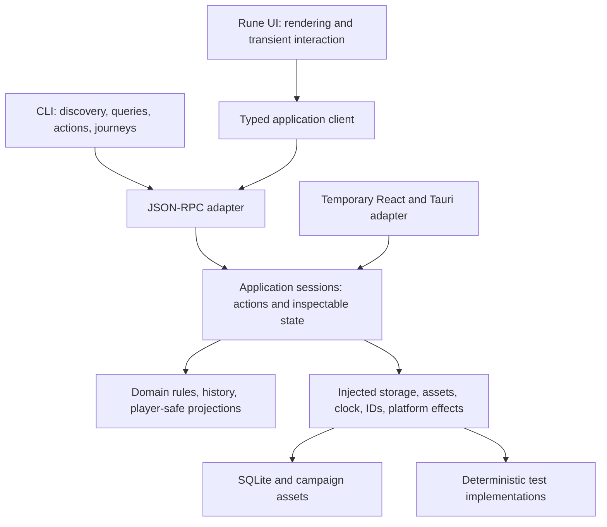

# Headless core, CLI, and Rune: discussion and migration plan

**Status: initial headless foundation implemented; broader migration remains a plan.** The direction is a JSON-RPC headless application core, a CLI that drives it, and a lightweight Rune frontend. See [Headless development](headless-development.md) for the working slice, checks, limitations, and capability ledger. This document proposes the remaining boundaries and migration gates; it does not authorize a full UI rewrite.

The current implementation is described in [Backend Architecture](backend-architecture.md). Existing feature documents remain the source of product requirements, including private GM content, portable campaigns, maps, notes, and player presentation. Replacing the renderer must not silently reduce those requirements.

## Why this direction

The goal is a short, trustworthy feedback loop for humans and agents:

1. Discover what the application can do.
2. Inspect meaningful state, without launching a window.
3. Invoke the same actions that the UI uses.
4. Observe completion, errors, and resulting state.
5. Prove a user journey with a deterministic behavior test.

JSON-RPC is the transport contract, not the architecture by itself. A CLI that edits SQLite while the UI implements validation, drafts, navigation, and presentation rules would not achieve this goal.

### What to take from Reflex

[Shopify's Reflex article](https://shopify.engineering/reflex) describes a UI-independent core, state-and-action ViewModels, introspection, and a CLI for headless behavior tests. The most useful principles here are:

- If a user can see meaningful application state, an agent can inspect it. If a user can perform an application action, an agent can invoke it through the same handler.
- Views read projections and dispatch actions; adapters do not duplicate business rules.
- Platform dependencies are injected at the edges.
- Most behavior tests run the real application logic without rendering, with fixtures at external boundaries.
- UI wiring, visual quality, accessibility, and real platform integration still require their own checks.

Do not copy every detail. Shopify maintains two native implementations and shares tests between them; we can share one Rust core. Its focused screen chain is also not a sufficient model for our split workspace and simultaneous GM/player views. We need explicit session and view targets rather than assuming one globally focused leaf.

### What Rune changes

[Rune](https://github.com/anomalyco/rune) is a native GPU-rendered Rust UI framework, not a React component library or a drop-in Tauri renderer. Its documentation describes headless screenshots, element trees, scripted input, text input, canvas gestures, and window lifecycle facilities. It is pre-release and recommends pinning a revision.

That supports a second feedback loop: validate behavior through the core, then validate rendering and input through Rune's headless tooling. Neither replaces the other.

“Lightweight” describes the frontend's responsibilities, not a guarantee that native maps, document editing, docking, or platform integration will be easy to implement.

## Proposed architecture

Proposed Rust boundaries, not committed crate names:

| Boundary | Owns | Must not own |
| --- | --- | --- |
| Core | Campaign working state, validation, action handling, revisions, saved-edit history, presentation rules, semantic navigation and editor sessions | Rune, React, Tauri, GPU objects, native dialogs |
| Infrastructure | SQLite repository, migrations, image processing, asset installation, platform service implementations | Independent business rules |
| Protocol/host | JSON-RPC framing, typed decoding, discovery, session routing, lifecycle, subscriptions | A second mutation implementation |
| CLI | Arguments, machine-readable output, exit status, connection/session selection | Direct database writes or bypasses around validation |
| Rune UI | Layout, painting, input binding, caret/selection, hover, animation, local gesture previews | Authoritative campaign or presentation mutations |

Start with fewer crates where practical. The essential enforcement is that the core and headless host build and test without Tauri, Rune, a display, or a GPU.

### State ownership

- **Core-owned working campaign:** the accepted in-memory campaign, including unsaved campaigns; clients stop sending an entire authoritative snapshot with every edit.
- **Core-owned application sessions:** open record/view identities, semantic navigation history, draft values and validation status where they affect workflows, and action availability. Each GM client gets an explicit session; presentation is campaign-level state.
- **Frontend-local interaction:** caret position, text composition, pointer capture, drag preview, hover, animation frames, measured layout, and GPU resources. A completed drag submits one semantic action, not one RPC per pointer move.
- **Persistence:** retain `.campaign` packages, SQLite, immutable assets, and existing migrations initially. Specify separately which session state survives restart.
- **Player output:** dedicated player-safe projections. A player client never receives full GM state and then hides fields visually.

Thin does not mean stateless or remote-rendered. Inspectable state should describe what a user is doing, not encode every pixel. Text-buffer undo and unsaved-draft editing need a deliberate relationship with saved-edit undo; moving them into one indiscriminate command stack would regress current behavior.

## Confirmed scope

- Waypoints is another tool by the same author and context for this direction, not a dependency or required reference implementation.
- The CLI runs independent headless sessions. Controlling or attaching to the running desktop app is not required.
- The Rune replacement must preserve current rich-note editing and dockable workspace capabilities. A deliberately reduced authoring experience is not the cutover target.
- Build the CLI, JSON-RPC host, core logic, and storage first; add the Rune frontend after the headless workflows work.
- Use embedded [Turso Database](https://github.com/tursodatabase/turso), the Rust SQLite-compatible engine, for the target storage adapter. This is not Turso Cloud or the older libSQL engine. The headless host now uses Turso; the desktop retains a temporary `rusqlite` adapter over shared domain types and schema.

### Turso storage gate

Pin a tested `turso` crate version before implementing the target adapter. Reuse the campaign schema, migration intent, and asset lifecycle, but port database calls to Turso's Rust API rather than assuming it is a drop-in `rusqlite` replacement.

Upstream documents SQLite file compatibility but not complete behavioral compatibility, and the engine is still pre-1.0. Before trusting the adapter with original campaign packages, test copies of existing databases and verify:

- Every SQL statement, schema migration, constraint, and pragma the repository relies on.
- Transaction commit/rollback and preservation of the previous campaign after failed saves.
- Save/reopen round trips, asset-reference consistency, locking, and journal/checkpoint behavior.
- A supported consistent backup procedure; do not assume SQLite's online backup API is available unchanged.
- The adapter's async runtime needs and clean shutdown under the long-lived headless host.

Keep existing campaign files and independent backups untouched during compatibility testing. Do not change the package format or adopt engine-specific file features silently. If compatibility fails, resolve the migration strategy explicitly before cutover.

The application CLI invokes domain actions through the core. Turso's own SQL CLI/MCP interface is not the application API: using it for campaign edits would bypass validation, history, and player-safety rules. Cloud services, replication, and experimental multi-process coordination are not required.

## Protocol and process model

**Recommendation:** one authoritative host per open campaign package, with serialized mutations. The CLI starts its own headless host; it does not attach to the desktop-owned session. Independent sessions do not imply concurrent write access: reject opening a package already owned by another writer, or use a separate campaign copy.

For the first slice, implement a long-lived headless process using newline-delimited JSON-RPC 2.0 over stdin/stdout. Keep logs on stderr. Starting a new process for each CLI command must not silently lose the campaign session or undo history; a journey can keep one connection open. No background daemon is required.

Desktop attachment, endpoint discovery, socket authentication, and remote control are outside this migration's scope. Campaign locking, child-process shutdown, and recovery after a broken stdio connection still need explicit behavior. No network listener is required.

The Rune UI should use a typed client for the same application contract. JSON-RPC for both clients is the default proposal because it exercises one external boundary. An in-process typed adapter is an alternative if measured latency or packaging warrants it, but it must retain the same dispatch, validation, and behavior tests.

### Contract to design before expanding features

These are capabilities, not final method names or CLI syntax:

- Discover protocol version, implemented actions/queries, input/output schemas, and supported capabilities. Generate schemas from the same typed definitions used for decoding; do not maintain parallel catalogs.
- Create/open/close a campaign session, inspect current state, list/get records, and inspect a targeted view.
- Dispatch an explicit typed action to a campaign/session/view target. Expose meaningful domain actions as well as UI navigation and draft workflows; agents should not need to simulate button clicks to author campaign data.
- Return accepted state revisions, structured domain errors, and history labels. Reject stale writes with expected-revision checks rather than overwriting concurrent changes.
- Subscribe to ordered state changes; support a fresh snapshot after reconnect or a detected revision gap. Start with snapshots before optimizing to patches.
- Define when an action is complete: accepted, applied, persisted, or waiting for an external effect. Long-running imports need operation status and cancellation semantics.

Use standard JSON-RPC errors for malformed requests and unknown methods, with a documented structured application-error convention for validation, not-found, conflict, storage, and permission failures. Request IDs correlate responses; they are not deduplication keys. Do not blindly retry a mutation after an ambiguous disconnect; define operation IDs and deduplication where retries are supported.

Discovery can describe all implemented actions; contextual state explains availability and validation. The dispatcher always enforces the rules, even if a client ignores the advertised availability.

Agent access is not automatically player access. Keep GM inspection separate from player-safe projections. Destructive changes and publication to players need explicit intent; an ordinary edit must not unexpectedly reveal GM content. Headless presentation tests can inspect projected state with fixture platform services without controlling a real player window.

## Migration strategy: replace boundaries before replacing screens

Today, the Rust campaign modules already separate validation, repository operations, migrations, and assets. NPC Save has a UI-independent service and Rust saved-edit history, but React still owns the working campaign, autosave orchestration, drafts, and many other mutations. This is a starting point, not yet a headless application.

Keep the existing app usable as a reference client during extraction. Do not build a second permanent product or maintain two independent rule sets. Move one workflow into the core, adapt the existing UI to it, then build its Rune view. Preserve the campaign format unless a specific feature requires a tested migration.

| Phase | Deliverable | Exit evidence |
| --- | --- | --- |
| 0. Inventory and decisions | Map current state/mutations and tests; agree on ownership, independent headless process lifecycle, initial protocol, target OSes, and rich-note/workspace parity criteria | Reviewed boundary/decision list and a bounded first slice |
| 1. Extract a runnable core | Plain Rust library with working campaign/session ownership and injected dependencies; introduce the embedded Turso storage adapter behind the repository boundary | Core tests run without UI dependencies; Turso storage gate passes on campaign copies; current save/load and NPC behavior remain covered |
| 2. Headless vertical slice | JSON-RPC host plus minimal CLI: create/open campaign, inspect, list/open NPC, edit/save NPC, undo/redo, save/reopen | A journey through the actual CLI/host demonstrates validation, persistence, stale-write rejection, history, and failures without a window |
| 3. Rune feasibility gate | Pinned Rune revision; NPC list/editor and player-safe preview using the same client; targeted high-risk UI spikes | Scripted input/tree/screenshot evidence, working native builds, and a documented parity/cost decision |
| 4. Migrate feature slices | Records, document workflows, assets, workspace/navigation, maps, and presentation incrementally move onto shared actions/state | Each slice has protocol journeys, legacy regression coverage, and Rune input/visual checks before old paths are removed |
| 5. Cutover and retire | Rune is the supported shell; remove obsolete React/Tauri paths and dependencies only after parity gates pass | Existing campaigns reopen without loss; packaging, recovery, permissions, accessibility, and multi-window checks pass on supported OSes |

Phase 2 is the first functional milestone: CLI → JSON-RPC → core → embedded Turso, with no Rune dependency. Phase 3 follows after the headless logic works. Decide feature ordering after the inventory; simple records can establish patterns, but prove the hard UI before committing to full frontend cutover.

### Rune feasibility gates

- **Notes:** load and preserve current Plate JSON, including images, captions, columns, and unknown nodes. Demonstrate required editing, selection, clipboard, IME, and undo. Rich text rendering and plain text fields do not prove a full document editor exists. Choose a native editor strategy or an explicit compatibility bridge; no lossy conversion by default.
- **Maps:** representative large images, pan/zoom, pin/token hit-testing, drag previews with one committed history entry, fog/grid rendering, and player-safe visibility. Measure responsiveness and memory with representative assets; basic canvas input support is not parity with Konva.
- **Workspace:** tabs, resizable splits, focus/keyboard routing, restored layout, and navigation. Dockview behavior must be replaced or intentionally redesigned, not assumed available.
- **Presentation/platform:** two independent windows, correct monitor targeting, close/stop behavior, frozen Live versus staged Next, native menus/dialogs, file associations, accessibility, and distribution.

If a gate fails, keep the core/CLI work and revise the shell implementation strategy or timeline, not silently drop required editing or workspace capabilities. Core extraction should remain valuable even if Rune adoption takes longer than expected.

## Validation and agent workflow

The wide middle of the test suite should be headless behavior journeys through the public contract, not tests that reach into private state:

- Author an NPC, reject an invalid edit without changing state/history, accept a valid edit, undo/redo, save, reopen, and verify.
- Preserve unsaved work after canceled or failed effects; never replace the current campaign on a failed open.
- Reject stale client edits and simultaneous writers. Recover a client from missed events without applying duplicate mutations.
- Assert private GM content is absent from player projections and Pause freezes Live until an explicit publication action.
- Import fixture assets and round-trip existing campaign versions with real storage in isolated temporary directories; verify missing/corrupt files and failed transactions.

Inject clocks, IDs, dialog outcomes, and external services. Use in-memory fakes for bounded behavior tests and the real SQLite/filesystem adapter for storage journeys. “Headless” does not mean all I/O is fake. Deny unexpected network access in behavior tests and fail on attempted access even if application code catches the error.

Failures should include the step, target, action, expected revision/state, actual state, and structured error, with bounded output and no secrets. Wait on revisions or operation completion with deadlines, not arbitrary sleeps.

Retain focused unit tests for primitives, a small real desktop integration suite, and Rune rendering/input checks. The initial phase must record baseline timing before setting CI budgets; do not borrow Shopify's performance numbers as promises for this app.

Once commands and fixture conventions stabilize, add a project skill teaching agents how to discover actions, run a safe temporary campaign, write a journey, and inspect failures. Architecture decisions still belong in documentation; operational skills complement rather than replace them.

## Questions for the next discussion

1. Which OS is the initial Rune development target, and which OSes must pass release gates?
2. Should campaign-edit undo survive restart? Recommendation: one labeled campaign-edit stream per campaign session, separate from local typing and presentation history. Independent CLI sessions do not join the running desktop session's in-memory history; restart durability remains a decision.
3. What native editor strategy can preserve current rich-note capabilities and Plate document compatibility? Prove this early alongside dockable workspace behavior.

## References

- [Reflex: an architecture for building mobile apps with agents](https://shopify.engineering/reflex)
- [Rune repository and pre-release guidance](https://github.com/anomalyco/rune)
- [Rune core documentation](https://github.com/anomalyco/rune/blob/dev/crates/rune/README.md)
- [JSON-RPC 2.0 specification](https://www.jsonrpc.org/specification)
- [Turso Database](https://github.com/tursodatabase/turso) and [SQLite compatibility reference](https://github.com/tursodatabase/turso/blob/main/COMPAT.md)
